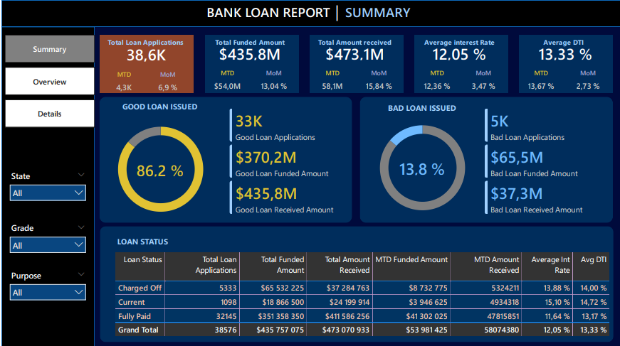
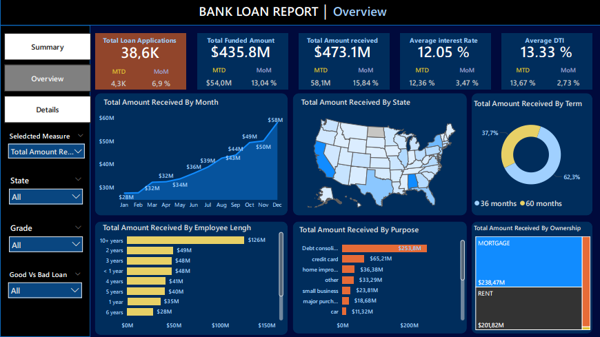
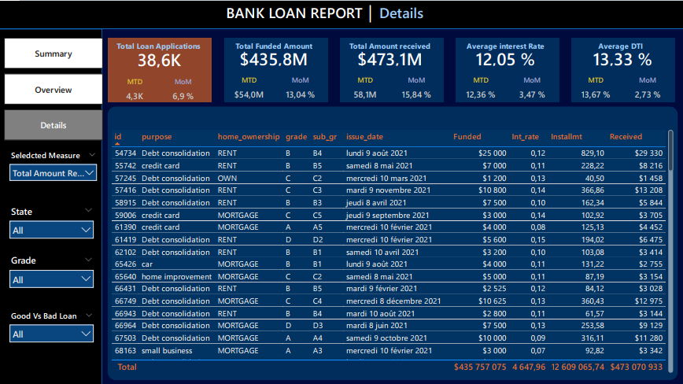
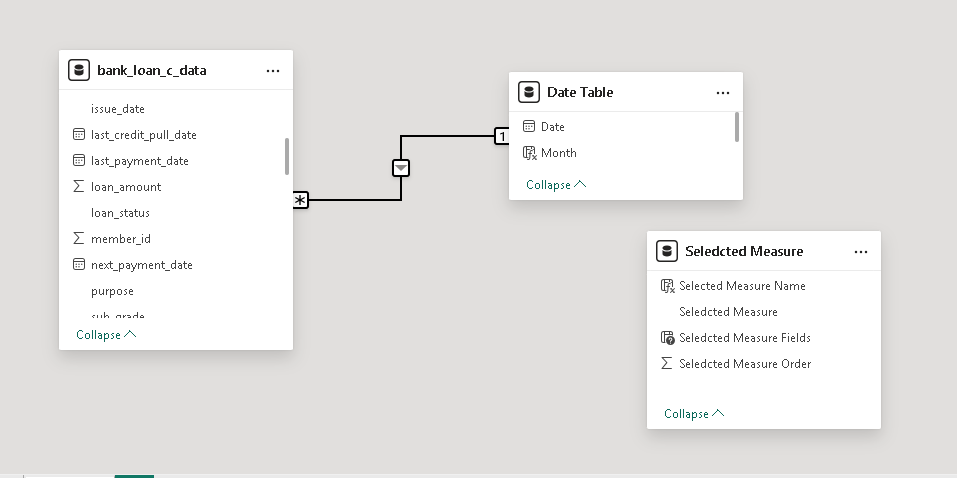

# Bank Loan Portfolio Analysis | Power BI & SQL Server

A three-page Power BI report for exploring loan applications, funding, amounts received, interest rates, debt-to-income ratios, and loan-status performance. The project combines SQL Server validation, Power Query data preparation, DAX measures, and deployment to Power BI Service through a standard on-premises data gateway.

**Author:** [Brice Abogo](https://www.linkedin.com/in/brice-abogo/)  
**Specialization:** Financial Analysis | Accounting | Business Intelligence  
**Technologies:** SQL Server | Power Query | DAX | Power BI | Power BI Service

---

## Explore the Project

- [**View the Complete Power BI Dashboard (PDF)**](reports/bank-loan-report.pdf)
- [**Explore Dashboard Screenshots**](docs/images/)
- [**View the Power BI Data Model**](docs/images/04_data_model.png)
- [**Read the Technical Documentation**](docs/)

---

## Dashboard Preview

### 1. Summary Page

### 2. Overview Page

### 3. Details Page

---

## Report Pages

| Page | Purpose |
|------|---------|
| **Summary** | Portfolio KPIs, good-versus-bad loan indicators, and a loan-status breakdown |
| **Overview** | Breakdowns by issue month, state, loan term, employment length, purpose, and home ownership |
| **Details** | Loan-level exploration within the report |

The report has been published to Power BI Service using an on-premises data gateway.

## Reported Portfolio Snapshot

The unfiltered report displays:

| Metric | Reported Value |
|--------|---------------:|
| Loan applications | 38,576 |
| Total funded amount | $435,757,075 |
| Total amount received | $473,070,933 |
| Average interest rate | 12.05% |
| Average debt-to-income ratio | 13.33% |
| Good loan applications | 33,243 (86.2%) |
| Bad loan applications | 5,333 (13.8%) |

## Metric Definitions

- **Loan applications:** count of non-blank loan IDs.
- **Funded amount:** sum of `loan_amount`.
- **Amount received:** sum of `total_payment`.
- **Average interest rate and DTI:** arithmetic averages of the underlying fractional values, displayed as percentages.
- **Good loan:** `loan_status` is `Fully Paid` or `Current`.
- **Bad loan:** `loan_status` is `Charged Off`.
- **MTD:** from the first day of the reference month through the reference date.
- **PMTD:** from the first day of the preceding month through its corresponding day, capped at that month's final day.
- **MoM:** `(MTD - PMTD) / PMTD`; undefined when the PMTD denominator is zero.

The good/bad classification is based on **loan status**, not on whether an individual loan's amount received exceeds its funded amount. For the displayed portfolio, good loans happen to have a higher *aggregate* amount received than aggregate funding; this observation is not the classification rule.

Amounts received are analyzed against **loan issue dates** in this model. Consequently, an "amount received by month" chart is **not** a payment-transaction-date cash-flow statement.

## Data Flow & Semantic Model

1. A CSV dataset is loaded into SQL Server as `dbo.bank_loan_c_data`.
2. Power Query loads the loan table and builds a date dimension.
3. The semantic model relates `Date Table[Date]` to `bank_loan_c_data[issue_date]`.
4. A Power BI group classifies the three observed loan statuses (`Fully Paid`, `Current`, `Charged Off`).
5. DAX measures calculate the report indicators.
6. SQL queries independently reconcile the dashboard totals and breakdowns.
7. The report is published to Power BI Service using an on-premises data gateway.

## Repository Contents

| Path | Description |
|------|-------------|
| [`sql/`](sql/) | SQL Server KPI and status-validation queries |
| [`power-query/`](power-query/) | Improved Power Query (M) reference implementations |
| [`dax/`](dax/) | DAX measure definitions and field-parameter documentation |
| [`docs/`](docs/) | Data dictionary, semantic model architecture, and gateway deployment guide |
| [`reports/`](reports/) | Complete Power BI dashboard exported in PDF format |
| [`data/`](data/) | Data-source notes; no raw dataset is distributed |

## Reproduction Prerequisites

- Power BI Desktop.
- SQL Server and access to the source dataset (`dbo.bank_loan_c_data`).
- Permission to connect to and refresh the SQL Server database.

Import the CSV into `dbo.bank_loan_c_data`, review SQL data types, and verify the expected row count (`38,576` rows). In Power BI Desktop, the reference Power Query code uses text parameters named `ServerName` and `DatabaseName`. The date query builds a continuous date table marked as the model's date table. Run the scripts in [`sql/`](sql/) with the project database selected in SQL Server Management Studio to reconcile all KPIs.

## License

This project is licensed under the MIT License — see the [`LICENSE`](LICENSE) file for details.

## Contact

**[Brice Abogo](https://www.linkedin.com/in/brice-abogo/)** — Accountant, Financial Analyst & Business Analyst (SQL, Power BI)
